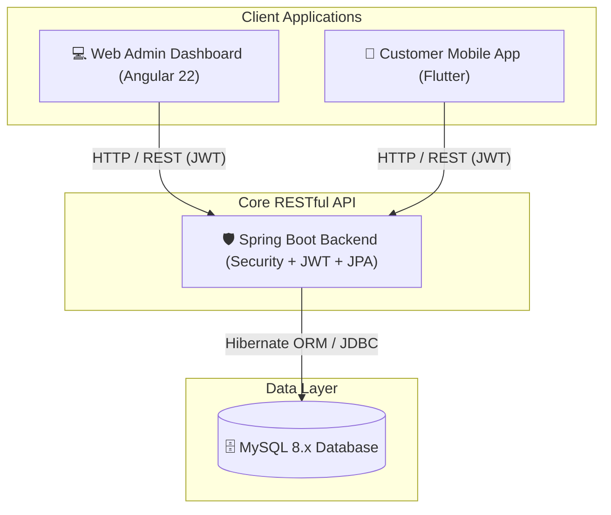

# 🛒 Omnichannel E-Commerce Platform (Monorepo)

An enterprise-ready, end-to-end **Omnichannel E-Commerce Monorepo** solution consisting of a **Spring Boot RESTful API**, an **Angular 22 Admin Back-Office Dashboard**, and a **Flutter Mobile App (iOS & Android)** for shoppers.

---

## 🏗 System Architecture



---

## 📦 Monorepo Modules

| Module | Directory | Technology | Target Users | Description |
|---|---|---|---|---|
| **Backend** | [`backend/`](./backend) | Spring Boot, Java 21+/25, MySQL, JJWT | System Services | Core REST API handling authentication, inventory, ordering state machine, categories, and procurement. |
| **Frontend** | [`frontend/`](./frontend) | Angular 22, Signals, TypeScript | Store Admins & Staff | Full-featured administrative web dashboard for catalog management, live stocks, orders, and system settings. |
| **Mobile** | [`mobile/`](./mobile) | Flutter 3.x, Dart | Customers & Shoppers | Native cross-platform mobile shopping experience with cart management, order tracking, and profile oversight. |

---

## 🌟 Key Capabilities

- **🔐 Enterprise Security & RBAC:**
  - Stateless authentication with JWT token lifecycle and blacklisting on logout.
  - Role-Based Access Control (`ROLE_ADMIN` vs `ROLE_CUSTOMER`).
- **🛍️ Catalog & Multi-level Categories:**
  - Dynamic parent-child category tree.
  - Multi-image upload and binary BLOB streaming for product galleries.
- **🛒 Dynamic Shopping Cart & Stock Validation:**
  - Real-time customer cart total calculation.
  - Stock decrement protection prevents overselling with `InsufficientStockException`.
- **📋 Order Workflow Engine:**
  - Automated transition through state machine: `PENDING` ➔ `PROCESSING` ➔ `SHIPPED` ➔ `DELIVERED`.
  - Admin rollback and customer cancellation controls.
- **🚚 Procurement & Buying Tracking:**
  - Supplier batch purchases recording with cost prices and quantity additions.
- **📱 Seamless Mobile Shopping Experience:**
  - Fast skeleton loading with shimmer effects, cached images, and clean responsive UI.

---

## 📂 Monorepo Structure

```text
e-commerce/
├── .gitignore                   # Master monorepo git ignore rules
├── README.md                    # Root project documentation (this file)
│
├── backend/                     # Spring Boot 4 REST API Service
│   ├── pom.xml                  # Maven dependencies & build definitions
│   ├── README.md                # Full API endpoint catalog & request samples
│   ├── src/                     # Java source code & JPA entities
│   └── mvnw                     # Maven wrapper script
│
├── frontend/                    # Angular 22 Admin Web Application
│   ├── package.json             # NPM package definitions & scripts
│   ├── README.md                # Angular app guide & architecture
│   ├── src/                     # Angular standalone components, signals & routes
│   └── angular.json             # Angular workspace configuration
│
└── mobile/                      # Flutter Cross-Platform Mobile Application
    ├── pubspec.yaml             # Flutter dependencies & assets
    ├── README.md                # Mobile setup, emulator & device run guide
    ├── lib/                     # Dart source code, screens, widgets & services
    ├── android/                 # Native Android host project
    └── ios/                     # Native iOS host project
```

---

## ⚡ Preloaded Default Credentials

When the backend boots for the first time, `DataInitializer` automatically ensures the following default administrative account exists:

- **Email:** `admin@email.com`
- **Password:** `123456`
- **Role:** `ADMIN`

---

## 🚀 Quick Start Guide

### 1. Database Setup

Ensure MySQL 8 is running and create the database:

```sql
CREATE DATABASE ecommerce_db CHARACTER SET utf8mb4 COLLATE utf8mb4_unicode_ci;
```

---

### 2. Run the Backend API

1. Navigate to [`backend/`](./backend):
   ```bash
   cd backend
   ```
2. Configure credentials in [`backend/src/main/resources/application.properties`](./backend/src/main/resources/application.properties):
   ```properties
   spring.datasource.url=your_datasource_url
   spring.datasource.username=your_user_name
   spring.datasource.password=your_mysql_password
   auth.token.jwtSecret=your_jwt_secret
   ```
3. Start the application:
   ```bash
   ./mvnw spring-boot:run
   ```
4. API will be live at `http://localhost:9191`.
   *(Refer to [backend/README.md](./backend/README.md) for full REST endpoint documentation).*

---

### 3. Run the Frontend Admin Dashboard

1. Navigate to [`frontend/`](./frontend):
   ```bash
   cd frontend
   ```
2. Install dependencies:
   ```bash
   npm install
   ```
3. Start the development server:
   ```bash
   npm start
   ```
4. Open your browser at `http://localhost:4200` and sign in with `admin@email.com` / `123456`.
   *(Refer to [frontend/README.md](./frontend/README.md) for detailed frontend documentation).*

---

### 4. Run the Mobile App (Flutter)

1. Navigate to [`mobile/`](./mobile):
   ```bash
   cd mobile
   ```
2. Configure the API base URL in [`mobile/lib/services/api/base_api_client.dart`](./mobile/lib/services/api/base_api_client.dart):
   - For **Android Emulator**: `http://10.0.2.2:9191/api/v1`
   - For **iOS Simulator**: `http://localhost:9191/api/v1`
   - For **Physical Device**: `http://<YOUR_LOCAL_IP>:9191/api/v1`
3. Fetch dependencies and launch:
   ```bash
   flutter pub get
   flutter run
   ```
   *(Refer to [mobile/README.md](./mobile/README.md) for platform-specific run steps).*

